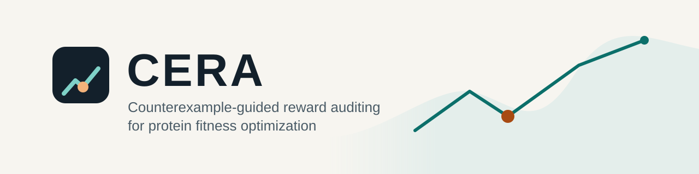
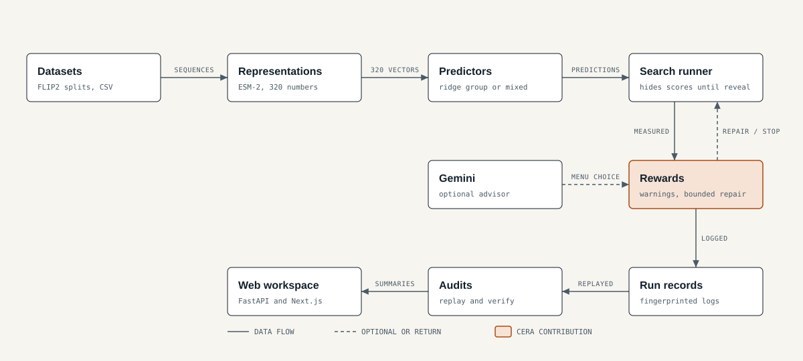

<p align="center"></p>

<div align="center">

# CERA

**A search that can change its mind.** Auditing, diagnosing and repairing unreliable learned rewards in protein fitness optimization.

 

</div>

## Why

Protein engineers choose which variants to measure next using a model that predicts fitness. When the model is wrong in a systematic way, the search keeps following it. CERA treats a disagreement between a prediction and a measured score as a counterexample: it records warnings, proposes a bounded change to the scoring rule, replays the change to check it, and stops when no safe change is found.

Everything here replays measured data from public benchmarks. No new laboratory experiments were run, and the results are exploratory, not official benchmark scores.

## Principles

- **Hidden until revealed.** The runner exposes a variant's measured score only after it has been selected within the budget, and logs each selection before its result.
- **Bounded, verified repair.** A repair may only change allowed reward weights, and it is kept only if a replay shows the flagged problem resolved. Language-model advice is optional and always re-checked by code.
- **Provenance first.** Run records store fingerprints of the data, caches and code. Audit scripts rebuild decisions from the records and check them.
- **Claims match evidence.** Each study states its limits. Ties, stops and exploratory findings are reported as such.

## Architecture

<p align="center"></p>

## Status

A working research prototype. The backend, the command-line studies and the local web workspace run and are tested. A 360-run four-protein comparison, two follow-up studies and several development checks are complete and audited. The comparison did not show that repair improves the final best score, and the proposed after-repair targets are not yet established. [Project status and results](docs/overview/status_and_results.md) has the numbers and what remains unproven.

## Quick start

```sh
python3 -m venv .venv
.venv/bin/pip install -r backend/requirements.txt
.venv/bin/uvicorn app.main:app --app-dir backend --host 127.0.0.1 --port 8000
cd frontend && npm ci && npm run build && npm run start -- --hostname 127.0.0.1
```

Open `http://127.0.0.1:3000`. The workspace is single-user and has no authentication, so keep both servers on the loopback address. Full setup, data download and a CPU-only install are in the [setup guide](docs/guides/setup.md).

Run the tests with `PYTHONPATH=backend:. python3 -m unittest discover -s backend/tests -t backend`.

## Documentation

- [Overview](docs/overview/status_and_results.md): current status and results, the [completion review](docs/overview/completion_review.md), [submission readiness](docs/overview/submission_readiness.md), the [roadmap](docs/overview/roadmap.md) and [how to reproduce results](docs/overview/reproducing_results.md).
- [Guides](docs/guides/setup.md): [setup](docs/guides/setup.md), [running studies](docs/guides/running_studies.md) and the [web workspace](docs/guides/web_workspace.md).
- [Studies](docs/studies/): protocol and findings for each study, grouped into [Amylase](docs/studies/amylase/), [repair](docs/studies/repair/), [warnings](docs/studies/warnings/), [multi-protein](docs/studies/multiprotein/) and [mixed predictor](docs/studies/hybrid/).
- [Background](docs/background/literature_review.md): literature review, dataset evidence, feasibility notes. [Data preparation](docs/data/) covers IRED and Hydro, and [data/SOURCES.md](data/SOURCES.md) lists sources and licences.
- [Workspace](docs/workspace/): the goal compiler, Gemini usage accounting and the local decision audit.
- [Work log](docs/history/work_log.md): decisions and checks in date order.
- [Glossary](docs/glossary.md): plain-word definitions of the terms used.
- [Saved results](output/README.md): which folder holds which study's records.
- [Report](report/CERA_final_report.pdf) and [slides](presentation/project_review.html) for review.
- [Brand](assets/brand/palette.md): palette and logo files.

## Contributing

Open an issue before large changes. Keep a change small, run the tests above, and do not edit saved records under `output/`: audits verify them by fingerprint.

## Licence

Code is released under the [MIT licence](LICENSE). The datasets keep their own licences, listed in [data/SOURCES.md](data/SOURCES.md).

<p align="center"></p>
