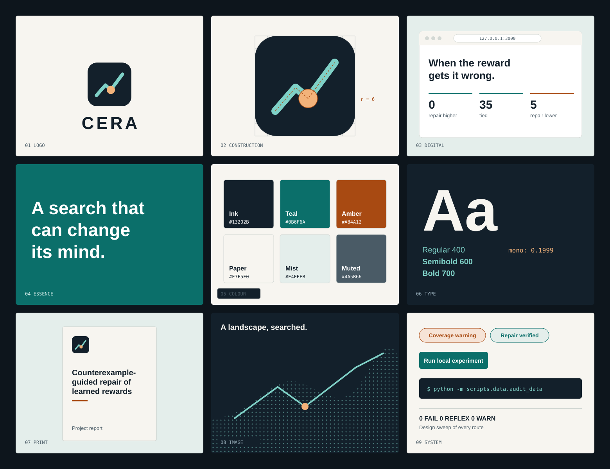

# Brand palette

Colors used by the website, README, report and slides

| Name | Hex | Use | Contrast |
| --- | --- | --- | --- |
| Ink | `#13202B` | Text, logo tile | 15.2:1 on paper |
| Teal | `#0B6F6A` | Primary actions, links, search path | 5.5:1 on paper, 6.0:1 on white |
| Amber | `#A84A12` | Warnings and counterexamples | 5.3:1 on paper, 5.8:1 on white |
| Muted | `#4A5B66` | Secondary text | 6.5:1 on paper |
| Paper | `#F7F5F0` | Page background | |
| Mist | `#E4EEEB` | Panels and fills | |
| Light teal | `#7FD1C7` | Teal on dark backgrounds | 9.3:1 on ink |
| Light amber | `#F2B27A` | Amber on dark backgrounds | 9.0:1 on ink |

Ratios are WCAG 2 contrast ratios; text needs at least 4.5:1.

## Brand board

Files: `logo-mark.svg`, `logo-horizontal.svg`, `banner.svg`, `footer.svg` and `brand-board.svg`. The mark is a search path that climbs, meets a counterexample (the amber dot) and changes direction. Type is the system sans stack with monospace for code and figures. The web interface uses these tokens in `frontend/app/globals.css`.
